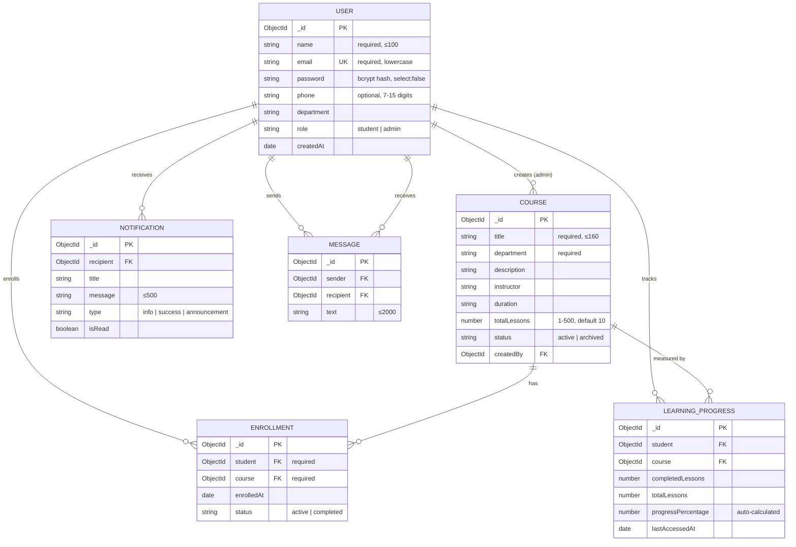

# Database schema & ER diagram (MongoDB / Mongoose)

## Constraints and indexes
| Collection | Constraint |
|---|---|
| users | `email` unique; `role` enum; `password` never returned by default |
| enrollments | **unique compound index** `(student, course)` – no duplicate enrollment |
| learningprogresses | **unique compound index** `(student, course)`; `progressPercentage` computed in a pre-save hook; completed ≤ total |
| notifications | index `(recipient, createdAt desc)` |
| messages | index `(sender, recipient, createdAt desc)`; text ≤ 2000 chars |
| courses | index on `title`; `totalLessons` 1–500 |

Deleting a course or student also deletes the related enrollments and progress records (done in the controllers).
